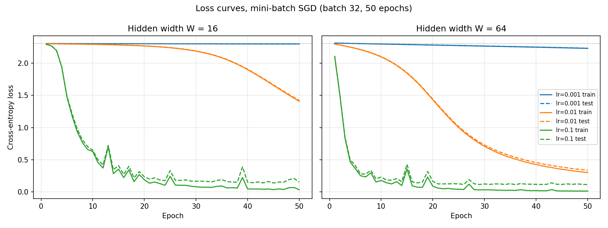

# Lab 2: a neural network from scratch

## Goal

Implement forward propagation and backpropagation with NumPy, check the
gradients numerically, and compare hidden widths and learning rates.

## Method

The digits dataset contains 1797 examples with 64 features and 10 classes.
Inputs are divided by 16 and labels are one-hot encoded. The stratified
70/30 split uses seed 42: 1257 training and 540 test examples.

Architecture: 64 → W → ReLU → W → ReLU → 10 → softmax.
W is either 16 or 64. Weight shapes are (64,W), (W,W), (W,10);
bias shapes are (W,), (W,), (10,). There are 1482 or 8970 parameters.
N(0,0.01) is interpreted as mean 0 and variance 0.01 (standard deviation 0.1).
Biases start at zero. Python and NumPy global seeds are set to 42.
Initialisation and shuffling use a NumPy generator with seed 42.

For each layer, Z = A_previous W + b. The hidden activation is max(0,Z).
Softmax subtracts the row maximum before exponentiation. Mean cross-entropy
uses log-sum-exp for numerical stability. Initial losses are 2.3032 (W=16)
and 2.3128 (W=64), close to ln(10)=2.3026.

The softmax derivative is ∂p_k/∂z_j = p_k(δ_kj − p_j).
Together with cross-entropy and labels summing to one, this gives
∂L_i/∂z_j = p_j − y_j. For a batch of N examples:

- dZ3 = (P − Y)/N; dW3 = A2ᵀ dZ3.
- dZ2 = (dZ3 W3ᵀ) ⊙ 1[Z2>0]; dW2 = A1ᵀ dZ2.
- dZ1 = (dZ2 W2ᵀ) ⊙ 1[Z1>0]; dW1 = Xᵀ dZ1.
- Each bias gradient is the row sum of its dZ.

Central differences use ε=1e-5 on 10 distinct random weights per width,
with 100 training examples. Weights with zero analytical gradients are
excluded. Relative error is |analytic−numeric| / max(|analytic|+|numeric|,1e-12).
Both widths passed 10/10 checks below 1e-6.

Training uses shuffled batches of 32 for 50 epochs. Runs of the same width
start from identical parameters and use identical shuffle orders. Different
widths have different parameter shapes, so their initial arrays are not identical.
Loss and test accuracy are logged after every epoch.

## Results

| Width W | Learning rate | Final train loss | Final test loss | Final test accuracy |
|---|---|---|---|---|
| 16 | 0.001 | 2.2976 | 2.2983 | 18.33% |
| 16 | 0.01 | 1.4072 | 1.4214 | 63.15% |
| 16 | 0.1 | 0.0342 | 0.1534 | 95.56% |
| 64 | 0.001 | 2.2291 | 2.2314 | 35.93% |
| 64 | 0.01 | 0.3002 | 0.3354 | 92.04% |
| 64 | 0.1 | 0.0145 | 0.1145 | 96.67% |

### Timing

Each operation is measured 100 times after one warm-up. The measurement
order is rotated between iterations, and the median is reported separately
for each operation. Backward reuses a cached forward pass. The matrix
products are also measured separately.

| Width W | Batch | Forward (ms) | Backward (ms) | Backward / forward | Forward matmuls (ms, share) | Backward matmuls (ms, share) | Forward MFLOP | Backward MFLOP |
|---|---|---|---|---|---|---|---|---|
| 16 | 32 | 0.0329 | 0.0367 | 1.12 | 0.0106 (32%) | 0.0161 (44%) | 0.09 | 0.12 |
| 16 | 1257 (full train) | 0.5475 | 0.5248 | 0.96 | 0.2645 (48%) | 0.2729 (52%) | 3.62 | 4.67 |
| 64 | 32 | 0.0518 | 0.0681 | 1.32 | 0.0263 (51%) | 0.0424 (62%) | 0.57 | 0.87 |
| 64 | 1257 (full train) | 1.2866 | 1.6283 | 1.27 | 0.5695 (44%) | 0.8636 (53%) | 22.20 | 34.11 |

For W=64, backward is slower than forward at both batch sizes. On the full
training set, forward takes 1.2866 ms and backward takes 1.6283 ms:
backward takes 1.27 times as long.

Forward has three matrix products; backward has five. Backward computes a
weight gradient for each layer and propagates the error through the last
two layers. For W=64 and 1257 examples, the products require 22.20 MFLOP
in forward and 34.11 MFLOP in backward, about 54% more arithmetic.
This helps explain why backward takes longer, although its time ratio
is not equal to the FLOP ratio.

For W=16 and 1257 examples, the passes are close: forward takes 0.5475 ms
and backward takes 0.5248 ms. Forward is slightly slower in this measurement.
Small matrix products do not determine the full pass time: forward also
computes activations and softmax, and NumPy calls have overhead.

The matrix-only times come from separate measurements. Their percentages
are approximate comparisons, not an additive profile of each pass.
Timing also depends on matrix sizes, BLAS and system load.

## Three conclusions

1. Of the tested rates, 0.1 produced the highest final accuracy for both widths.
2. Width 64 reached higher final accuracy at every tested learning rate;
   this comparison applies to these six runs and this seed.
3. At W=64, backward was slower: 1.27 times the forward time on the full
   training set. Its five matrix products do more work than forward's three.
   At W=16 the full-set times were close, so size and overhead also matter.

## Reproducibility and limitations

See results/versions.txt for the actual Python and package versions and
results/environment_check.txt for the supplied dependency conflict.
The comparison uses one seed, 42, and does not measure variation across
seeds. Test results are monitored each epoch, so the best configuration
is not an independent final evaluation.
