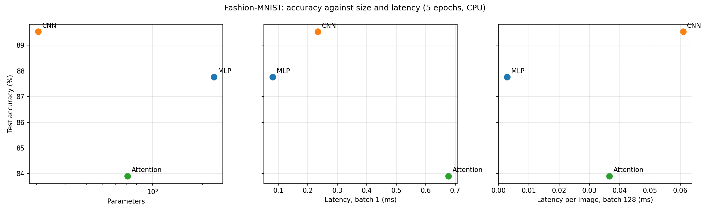

# Lab 3: architectures and their costs

## Goal

Build an MLP, a CNN and a small attention model in PyTorch, count their
parameters and FLOPs by hand and with profiling tools, measure inference
latency, train them on Fashion-MNIST and decide which one gives the most
accuracy for its cost.

## Method

**Data.** `torchvision.datasets.FashionMNIST` with `ToTensor()` and
`Normalize((0.2860,), (0.3530,))`. The official 60k training set is split
into 55k training and 5k validation images with `random_split` (seed 42);
the official 10k test set is used for the final accuracy. Batch size 128.
Seeds: `random`, NumPy and PyTorch are all seeded with 42.

**Models** (exactly as specified in the manual):

| Model | Layers | Parameters (torchinfo) |
|---|---|---|
| MLP | Flatten 784 → Linear 256 → ReLU → Linear 128 → ReLU → Linear 10 | 235,146 |
| CNN | Conv 1→16 (3×3, pad 1) → ReLU → MaxPool 2 → Conv 16→32 → ReLU → MaxPool 2 → Linear 1568→10 | 20,490 |
| Attention | 16 patches of 7×7 → Linear 49→64 → 2 Transformer encoder layers (d_model 64, 4 heads, feed-forward 128) → mean pool → Linear 64→10 | 70,794 |

The manual asks for models of similar size (100k-150k parameters), but the
architectures it prescribes do not land there: the MLP has 235k parameters,
the CNN 20k and the attention model 71k. I kept the prescribed layers, so the
comparison is between models of different sizes. The attention model has no
positional encoding (none is listed), so it sees the 16 patches as an
unordered set: it uses the content of each patch without any explicit
information about where the patch was in the image.

**FLOPs by hand** use the Chapter 4 formulas for one image and count matrix
products only (bias additions, ReLU, pooling, softmax and LayerNorm are left
out): Linear 2 × in × out, Conv2d 2 × K × K × C_in × C_out × H_out × W_out,
attention QKV 2 × seq × d × 3d, scores and the weighted sum 2 × seq² × d each,
output projection 2 × seq × d², feed-forward 2 × 2 × seq × d × d_ff, with
seq = 16, d = 64, d_ff = 128. The full per-layer list is in
`results/hand_flops_by_layer.csv`.

**Measured FLOPs.** `thop.profile` on one image (it reports multiply-accumulate
operations, MACs), and PyTorch's own `FlopCounterMode` as a second reference.

**Latency.** CPU (Ryzen 5 5600U laptop, 6 PyTorch threads), `eval()` and
`inference_mode()`, one warm-up call, then the median of 100 runs for batch 1
and of 20 runs for batch 128. Latency was measured before training; the
weights do not change how much work a forward pass does.

**Training.** Adam, learning rate 1e-3, batch 128, 5 epochs, cross-entropy.
Validation accuracy is logged after every epoch (`results/training_log.csv`),
test accuracy is measured once at the end.

## Results

### Hand-calculated vs measured FLOPs (one image)

One layer of each type:

| Layer | Hand formula | Hand FLOPs |
|---|---|---|
| Linear 784→256 (MLP) | 2 × 784 × 256 | 401,408 |
| Conv2d 16→32, 14×14 output (CNN) | 2 × 3 × 3 × 16 × 32 × 14 × 14 | 1,806,336 |
| Attention: QKV projections | 2 × 16 × 64 × 3 × 64 | 393,216 |
| Attention: scores Q·Kᵀ | 2 × 16² × 64 | 32,768 |
| Attention: weighted sum A·V | 2 × 16² × 64 | 32,768 |
| Attention: output projection | 2 × 16 × 64 × 64 | 131,072 |
| Attention: feed-forward | 2 × 2 × 16 × 64 × 128 | 524,288 |
| Whole encoder layer | | 1,114,112 |

Whole models:

| Model | Hand FLOPs | thop MACs | thop MACs × 2 | thop MACs, fast path off | PyTorch FlopCounterMode |
|---|---|---|---|---|---|
| MLP | 469,504 | 234,752 | 469,504 | 234,752 | 469,504 |
| CNN | 2,063,488 | 1,031,744 | 2,063,488 | 1,031,744 | 2,063,488 |
| Attention | 2,329,856 | 50,816 | 101,632 | 591,488 | 2,198,784 |

**Why the numbers differ.**

1. thop counts multiply-accumulates, and one MAC is two FLOPs. After doubling,
   the MLP and the CNN match the hand count exactly, and so does PyTorch's
   counter.
2. For the attention model thop finds only the patch embedding and the
   classifier (50,816 MACs). It measures inside `torch.no_grad()`, and in
   that mode PyTorch runs each `TransformerEncoderLayer` as one fused kernel,
   so the hooks thop puts on the inner layers never fire. With the fast path
   switched off, thop sees the feed-forward layers and LayerNorm
   (591,488 MACs), but still nothing from the attention block itself:
   it does not count `MultiheadAttention`, whose projections and
   matrix products are called as functions, not as modules.
3. PyTorch's counter gets everything except 131,072 FLOPs, which is exactly
   Q·Kᵀ plus A·V (2 × 32,768 per layer, two layers). On CPU these two products
   run inside `scaled_dot_product_attention`, which this version of the counter
   does not count.

So the hand count is the most complete number here, and a profiler result is
only as good as the operations it knows about.

### Accuracy, size and latency

| Model | Parameters | Hand FLOPs | Test accuracy | Latency batch 1 (ms) | Latency batch 128 (ms) | Per image at batch 128 (ms) |
|---|---|---|---|---|---|---|
| MLP | 235,146 | 469,504 | 87.76% | 0.081 | 0.36 | 0.0028 |
| CNN | 20,490 | 2,063,488 | 89.53% | 0.234 | 7.79 | 0.0609 |
| Attention | 70,794 | 2,329,856 | 83.91% | 0.677 | 4.68 | 0.0365 |

Validation accuracy after each epoch:

| Model | Epoch 1 | Epoch 2 | Epoch 3 | Epoch 4 | Epoch 5 |
|---|---|---|---|---|---|
| MLP | 84.28% | 85.68% | 87.08% | 87.88% | 88.26% |
| CNN | 86.58% | 88.44% | 88.64% | 89.58% | 89.66% |
| Attention | 79.02% | 81.48% | 82.36% | 83.00% | 83.98% |

### Trade-offs and access patterns

The work each model does per image is decided by how it touches memory, not
only by its FLOP count. Achieved arithmetic rate (hand FLOPs divided by the
measured latency):

| Model | GFLOP/s at batch 1 | GFLOP/s at batch 128 |
|---|---|---|
| MLP | 5.8 | 166.9 |
| CNN | 8.8 | 33.9 |
| Attention | 3.4 | 63.7 |

- **MLP: dense, sequential access.** Each of its 234,752 weights is read once
  per image and used for one multiply-add, so at batch 1 the three
  matrix-vector products are limited by reading the weights and by call
  overhead. At batch 128 the same weights are reused for all 128 images, the
  products become large matrix-matrix multiplications, and the MLP reaches the
  highest rate of the three. It is the fastest model at both batch sizes, but it stores the most
  parameters (0.94 MB) and ignores that neighbouring pixels belong together.
- **CNN: local, shared access.** Weight sharing means a 3×3 kernel is reused at
  every position, so the CNN needs only 20,490 parameters (11 times fewer
  than the MLP) and still does 4.4 times more FLOPs. That locality is also why
  it is the most accurate model (89.53 %). On this CPU it is the slowest per
  image at batch 128 (0.0609 ms): the first layer has one input channel, so
  each output needs only 9 multiply-adds while the 28×28×16 feature maps still
  have to be written, read, activated and pooled. With so few channels the
  convolutions most likely move a lot of activation data for little arithmetic.
- **Attention: all-to-all, data-dependent access.** Every patch is compared with
  every other patch (a 16×16 score matrix per head), and around the matrix
  products there are many small steps: unfolding the image, splitting heads,
  softmax, LayerNorm and residual additions. At batch 1 these small kernels
  dominate, so it is the slowest model (0.677 ms, 8.4 times the MLP).
  At batch 128 its projections and feed-forward layers turn into large dense
  matrix products (2048 tokens × 64), the likely reason it is faster per image
  than the CNN despite more FLOPs. With only 16 patches and no positional encoding,
  its global view brings no accuracy advantage here (83.91 %).

**Most cost-effective: the CNN.** It has the best accuracy and the smallest
model, and its batch-1 latency (0.234 ms) is far inside any interactive
budget. If the cost that matters is CPU throughput on large batches, the MLP
is about 22 times cheaper per image for 1.77 points less accuracy. The
attention model is not cost-effective at this scale: it is less accurate than
both and slower than the MLP at every batch size.

## Three conclusions

1. **FLOP counts have to be checked against what the profiler can see.** By hand
   and by PyTorch's counter the MLP and the CNN agree exactly, and thop agrees
   once MACs are doubled. For the attention model thop reported only
   101,632 of 2,329,856 FLOPs, because the encoder runs as a fused kernel and
   thop does not count multi-head attention.
2. **Fewer parameters or FLOPs do not mean lower latency.** The CNN has the
   fewest parameters but is the slowest per image at batch 128; the attention
   model has the most FLOPs but is faster than the CNN at batch 128 and the
   slowest at batch 1. Memory access and the number of small operations decide
   the time as much as the arithmetic does.
3. **The CNN gives the best accuracy for its cost on Fashion-MNIST.** Its local,
   shared weights fit image data, giving 89.53 % with 20,490 parameters, against
   87.76 % for the 235,146-parameter MLP and 83.91 % for the attention model after the same
   5 epochs.
