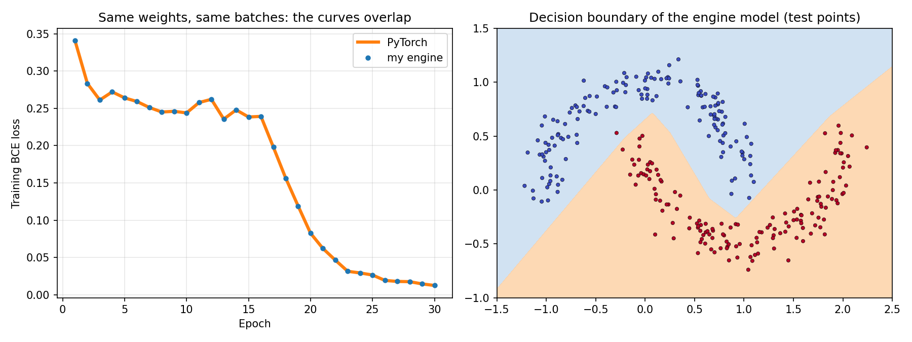

# Lab 5: frameworks and automatic differentiation

## Goal

Build a small automatic-differentiation engine that works on single numbers,
check it against PyTorch autograd and numerical gradients, train a tiny
network with it, and use PyTorch to look at computation graphs, execution
modes (eager vs compiled or traced) and memory layout (contiguous vs
non-contiguous tensors).

## Method

**1. The `Value` node** (`src/engine.py`) stores:

- `data`, the number itself;
- `grad`, the derivative of the final output with respect to this number
  (starts at 0);
- `parents`, the Values it was computed from;
- `op`, the name of the operation that produced it;
- `_backward`, its local derivative rule: a small function that takes this
  node's gradient and adds the right amount to each parent.

**2. Operations.** Every operation returns a new Value that records its
parents and its rule, so running the forward pass builds the computation
graph at the same time.

| Operation | Forward | Rule in backward |
|---|---|---|
| a + b | a + b | a.grad += out.grad; b.grad += out.grad |
| a * b | a · b | a.grad += b · out.grad; b.grad += a · out.grad |
| a ** k (constant k) | aᵏ | a.grad += k · aᵏ⁻¹ · out.grad |
| relu(a) | max(0, a) | a.grad += (1 if a > 0 else 0) · out.grad |

For training I added `exp`, `log` and `sigmoid` with the same pattern.
Subtraction, negation and division are built from the four operations above
(a − b = a + (−1)·b, a / b = a · b⁻¹).

**3. Backward pass.**

1. Sort the graph topologically, so every node comes after the nodes it was
   computed from. The sort is an iterative depth-first search; a recursive
   one would hit Python's recursion limit on the training graphs.
2. Set the output gradient to 1.
3. Visit the nodes in reverse order and call each local rule.

The rules always add (`+=`), never assign. A node used twice must receive the
sum of both contributions.

**4. Verification.** The test expression is `((a*b + c)**2).relu().sum()`,
with a, b and c random vectors of 10 values (seed 42). It is computed three
ways:

- with my engine;
- with PyTorch autograd in float64;
- with central differences (ε = 1e-6) on a separate NumPy version of the same
  formula.

A second test reuses nodes on purpose: with x = 1.5 and y = −2,

- d = x·y,
- e = d² + d + x,
- out = relu(e·x + d).

Here d appears three times and x four times, which checks that gradients
accumulate correctly.

**5. make_moons.**

- **Data:** 1000 points, noise 0.1, seed 42, split 70/30 with stratification.
- **Network:** 2 → 8 (ReLU) → 1 (sigmoid), BCE loss.
- **Training:** plain SGD, learning rate 1.0, batch 16, 30 epochs.
- **Same start for both:** my engine and PyTorch (float64) start from the
  same initial weights (`nn.Linear`-style uniform init) and see the batches in
  the same order. So they should follow the same path step by step.
- **Speed:** the whole training is timed as the median of 5 runs after
  1 warm-up.
- **Why lr 1.0:** with lr 0.5 and batch 32, both implementations got stuck at
  a loss of about 0.23 (about 90 % accuracy); lr 1.0 with batch 16 gets past
  that plateau.

**6. PyTorch.**

- **Graph:** the autograd graph of the trained model is printed by following
  `grad_fn`, and its forward graph is captured with `torch.fx`.
- **torch.compile:** tried first, with `fullgraph=True` so that a failure
  cannot be hidden by a silent fallback to eager.
- **Tracing:** after compile failed, models and functions are traced with
  `torch.jit.trace`.
- **Timing:** eager and traced calls alternate (a, b, a, b, ...) after
  3 warm-up calls each, so a change in CPU speed affects both equally. The
  median of 2000 runs is used for the small model and of 100 runs for the
  large cases.
- **Tensor layout:** shape, dtype, stride and contiguity are inspected for a
  4096×4096 tensor, its transpose (a view) and a contiguous copy. Five
  operations are timed on the transposed view and on the contiguous copy
  (alternating, median of 30).

Everything runs with `python lab05/src/lab5.py` on a laptop CPU (Ryzen 5
5600U, 6 PyTorch threads, PyTorch 2.3.1).

## Results

### My engine matches PyTorch

| Check | Result |
|---|---|
| Output of the expression | 8.215245855751819 (engine) vs 8.21524585575182 (PyTorch) |
| Max gradient difference, engine vs PyTorch (30 inputs) | 0.0 |
| Max gradient difference, engine vs numerical | 9.1e-10 |
| Nodes in the engine's graph | 81 |
| Reused-node test, ∂out/∂x | 22.0 (engine), 22.0 (PyTorch) |
| Reused-node test, ∂out/∂y | −9.75 (engine), −9.75 (PyTorch) |

Both differences are far below the required 1e-6. Every input is listed in
`results/gradient_check.csv`.

The reused-node values can be checked by hand. With x = 1.5 and y = −2:
d = −3 and e = 9 − 3 + 1.5 = 7.5. Since out = e·x + d > 0:

- ∂out/∂x = e + x·∂e/∂x + ∂d/∂x = 7.5 + 1.5·((2d+1)·y + 1) + y
  = 7.5 + 1.5·11 − 2 = 22;
- ∂out/∂y = x·(2d+1)·x + x = 1.5·(−5)·1.5 + 1.5 = −9.75.

If the rules assigned instead of adding, only the last path to x and y would
survive and these numbers would be wrong.

### Training on make_moons

| | My engine | PyTorch |
|---|---|---|
| Test accuracy | 99.67 % | 99.67 % |
| Final training loss | 0.012437 | 0.012437 |
| Largest loss difference over 30 epochs | 1.1e-16 | |
| Largest parameter difference after training | 2.7e-15 | |
| Training time, median of 5 runs | 27.08 s | 1.29 s |

The two implementations follow the same path down to floating-point rounding.
PyTorch is 20.9 times faster. My engine creates a Python object for every
single multiplication and addition, about 60,000 per epoch, and calls a Python
function for each one in backward. PyTorch processes a whole batch with one
matrix operation in C++.

### Graph inspection in PyTorch

Walking `grad_fn` from the loss gives the reverse graph that autograd will run
(`results/torch_graph.txt`):

- BinaryCrossEntropyBackward0
  - SigmoidBackward0
    - AddmmBackward0: output layer, x·Wᵀ + b in one operation
      - AccumulateGrad → bias (1,)
      - ReluBackward0
        - AddmmBackward0: hidden layer
          - AccumulateGrad → bias (8,)
          - TBackward0
            - AccumulateGrad → weight (8, 2)
      - TBackward0
        - AccumulateGrad → weight (1, 8)

This is the same structure as my engine, but at the level of whole tensors:
`AccumulateGrad` is where gradients are added into parameters, the job my
`+=` rules do. `torch.fx` shows the forward graph as 4 module calls
(Linear → ReLU → Linear → Sigmoid). All parameters are float64 and contiguous.

### Eager vs compiled or traced

`torch.compile` does not work on this machine. Its default backend, inductor,
failed with `BackendCompilerFailed`: the Python code it generates contains a
Windows path with backslashes and cannot be imported, and it also needs a
C++ compiler that is not installed. PyTorch 2.3.1 does not support inductor on
Windows (its own source code raises "Windows not yet supported for inductor").
So, as the manual allows, I used `torch.jit.trace`.

| Case | Eager (µs) | Traced (µs) | Speed-up | Same output |
|---|---|---|---|---|
| 2-8-1 MLP, batch 1 | 68.3 | 52.2 | 1.31× | yes |
| 2-8-1 MLP, batch 1024 | 162.9 | 143.2 | 1.14× | yes |
| 784-1024-1024-10 MLP, batch 256 | 6,771.7 | 6,695.6 | 1.01× | yes |
| 7 element-wise ops on 1M values | 5,553.1 | 5,553.2 | 1.00× | yes |

### Shape, dtype and contiguity

| Tensor | Shape | dtype | Stride | Contiguous | Shares memory with x |
|---|---|---|---|---|---|
| x | (4096, 4096) | float32 | (4096, 1) | yes | yes |
| x.t() | (4096, 4096) | float32 | (1, 4096) | no | yes |
| x.t().contiguous() | (4096, 4096) | float32 | (4096, 1) | yes | no |

The transpose is only a view: the same memory with swapped strides. Because
its elements are not in row order, `x.t().view(-1)` fails; `.contiguous()`
makes a reordered copy first.

| Operation | Non-contiguous (ms) | Contiguous (ms) | Slower by |
|---|---|---|---|
| t * 2 (one input) | 9.65 | 9.52 | 1.01× |
| t + y (y contiguous) | 37.33 | 11.71 | 3.19× |
| t.sum(dim=1) | 13.26 | 5.59 | 2.37× |
| t @ w (4096×256) | 59.04 | 48.70 | 1.21× |
| t.contiguous() | 41.17 (copies 64 MB) | 0.01 (returns itself) | |

- **One input (t * 2):** a non-contiguous view costs nothing. PyTorch walks
  the memory in its real order and writes the output in the same layout.
- **Mixing layouts (t + y):** this is 3 times slower, because one of the two
  inputs has to be read with a jump of 4096 floats between neighbours, which
  wastes the cache.
- **Row reduction (t.sum(dim=1)):** this is 2.4 times slower for the same
  reason.
- **Matrix product:** this only loses 21 %, because BLAS handles a transposed
  matrix directly.

## When compilation helps

Compiling or tracing removes the Python work around the operations: calling
each module, checking arguments, dispatching every operation. It does not make
the operations themselves faster. So it helps most when that overhead is a
large part of the time: small models, small batches, many small operations.
Tracing made the 2-8-1 network 31 % faster at batch 1 and 14 % faster at batch
1024. When the time goes into large matrix products, as in the 784-1024-1024-10
network, BLAS does the same work either way and the gain is about 1 %.

A real compiler such as inductor can also fuse chains of element-wise
operations into one loop, so the data is read from memory once instead of
once per operation. TorchScript tracing on CPU does not fuse by default
(`torch._C._jit_can_fuse_on_cpu()` returns False), so the 7-operation chain
did not speed up at all. Compilation also has a cost: tracing or compiling
takes time, and the first calls are slower. It pays off only for code that
runs many times with the same shapes.

## Three conclusions

1. **Reverse-mode autodiff is a graph plus local rules.** My engine (167
   lines, including the tiny network) matches PyTorch exactly (difference 0.0)
   and numerical gradients to 1e-9.
   The two details that matter most are visiting nodes in reverse topological
   order and adding gradients instead of overwriting them.
2. **The engine is correct but slow.** It trains the same model to the same
   99.67 % with the same weights, but 21 times slower. Frameworks win by
   working on whole tensors in compiled code instead of one number at a time in
   Python.
3. **Speed depends on overhead and memory layout, not only on the math.**
   Tracing helped only where Python overhead dominated (up to 1.31×).
   Non-contiguous views are free for some operations but up to 3 times slower
   for others. `torch.compile` could not be used on Windows with PyTorch 2.3.1.
