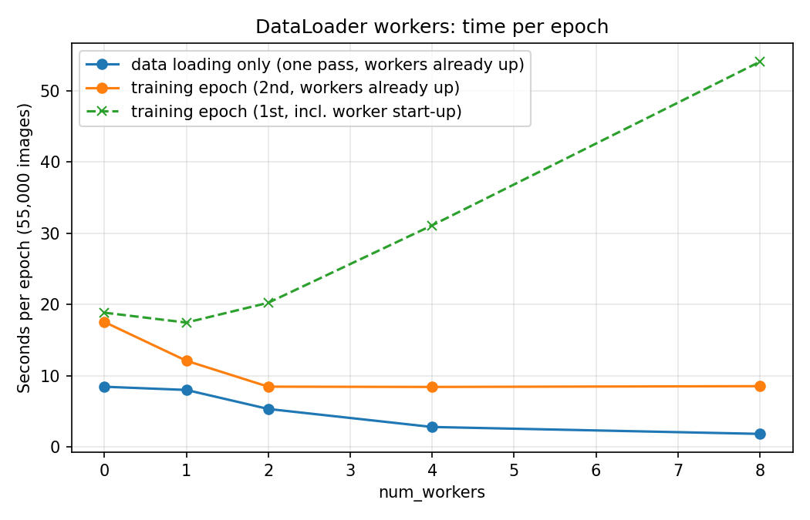
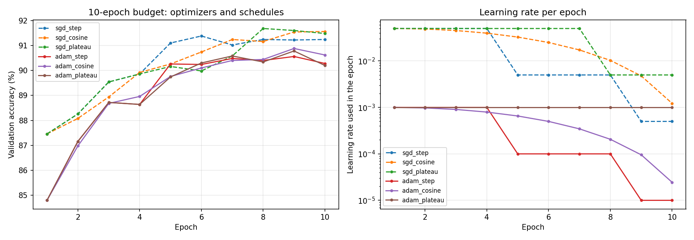
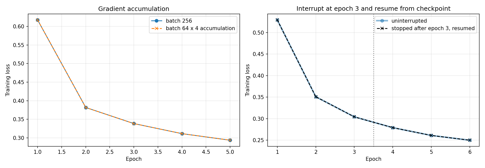

# Lab 6: training pipelines and project proposal

## Goal

Turn the training of my best Lab 3 model into a reproducible pipeline driven
by one YAML config, with checkpoints and MLflow tracking. Then use it to
profile training and to study how worker count, batch size, optimiser,
learning-rate schedule and gradient accumulation change speed, memory and
accuracy. Check that an interrupted run resumes exactly, and propose an
individual project.

## Method

**Model.** The CNN from Lab 3:

- conv 1→16 → pool → conv 16→32 → pool → linear 1568→10;
- 20,490 parameters;
- 89.53 % test accuracy in Lab 3.

Fashion-MNIST is split as before: 55,000 training, 5,000 validation and
10,000 test images.

**Pipeline** (`src/train.py`, `config.yaml`):

- **One config:** a single YAML object holds every setting: seed, data,
  model, optimiser, scheduler, accumulation, checkpoint folder and MLflow
  experiment. A run is `python lab06/src/train.py --config lab06/config.yaml`,
  and any key can be overridden, e.g. `--set train.lr=0.05`.
- **Checkpoints:** after every epoch, a checkpoint stores the model,
  optimiser, scheduler, history and all random-number states (Python, NumPy,
  PyTorch and the data-order generator). This lets `--resume` continue
  exactly where the run stopped.
- **MLflow:** every run logs the full config as params, per-epoch metrics
  (train loss, val loss, val accuracy, lr, epoch time, samples/s and, when
  enabled, peak memory) and the test accuracy. It also stores the resolved
  config and the history as artifacts; the main run also stores its
  checkpoint.

**Studies** (`src/experiments.py`):

- Every training run is a separate `train.py` process with a few overrides,
  so memory and DataLoader workers start clean each time.
- All 21 runs are in `mlruns/`, experiment `lab06-training-pipeline`. To see
  them: `mlflow ui --backend-store-uri lab06/mlruns`. They are also exported
  to `results/mlflow_runs.csv`.
- **Profiling:**
  - one epoch at batch 128 with `num_workers=0`;
  - the loop is split into the 4 phases with `torch.profiler.record_function`;
  - each phase is also timed with a wall clock.
- **Workers:** `num_workers` in [0, 1, 2, 4, 8]. For each value I measured:
  - the time to start the workers (until the first batch);
  - one pass over the data with no model;
  - two training epochs: the first includes the worker start-up, the second
    runs with the workers already up.
- **Batch size:** [32, 64, 128, 256, 512], 5 epochs each with Adam (lr
  1e-3). I measured throughput, peak process memory (RSS, sampled every 2 ms)
  and test accuracy.
- **Schedules:** each schedule was run with each optimiser, 6 runs with
  10 epochs each.
  - Schedules: StepLR (×0.1 every 4 epochs), CosineAnnealingLR over 10 epochs,
    and ReduceLROnPlateau (×0.1 after 1 epoch without val-loss improvement).
  - Optimisers: SGD with momentum 0.9 (lr 0.05) and Adam (lr 1e-3).
- **Gradient accumulation:** batch 256 against batch 64 with 4 accumulation
  steps. Gradients are summed over the 4 batches and divided by the number of
  samples in the group, so the update is the same as one batch of 256. Both
  runs see the samples in the same order.
- **Resume:** a 6-epoch run with a cosine schedule, compared with the same
  run stopped after epoch 3 and continued from its checkpoint in a new
  process.

Everything ran on the laptop CPU (Ryzen 5 5600U, 6 PyTorch threads) with
Python 3.11.8 and the pinned packages (`results/versions.txt`).

## Results

### Main run (the pipeline itself)

5 epochs, Adam lr 1e-3, batch 128: **test accuracy 89.21 %**, val accuracy
89.74 % (`results/main_run.csv`). This is in line with Lab 3 (89.53 %); the
batch order differs slightly. Epochs take 18-21 s.

### Profile of one epoch (`results/profile_breakdown.csv`)

| Phase | Profiler time | Share | Wall-clock time | Share |
|---|---|---|---|---|
| Data loading | 13.60 s | 62.3 % | 13.61 s | 62.2 % |
| Forward pass | 3.32 s | 15.2 % | 3.33 s | 15.2 % |
| Backward pass | 4.24 s | 19.4 % | 4.25 s | 19.4 % |
| Optimizer step | 0.66 s | 3.0 % | 0.67 s | 3.1 % |
| Whole epoch | | | 21.88 s | |

**Data loading takes almost two thirds of the epoch.** With `num_workers=0`,
each of the 55,000 images is turned into a tensor and normalised one by one in
the main process: `aten::div` and `aten::eq` run 57,580 and 55,000 times in
`results/profile_top_ops.txt`. The model itself is small, so forward,
backward and the optimizer step together take only about 8.2 s.

### num_workers (`results/num_workers.csv`)

| num_workers | Worker start-up | Data only, one pass | Training epoch 1 | Training epoch 2 | Samples/s (epoch 2) |
|---|---|---|---|---|---|
| 0 | 0.06 s | 8.46 s | 18.86 s | 17.55 s | 3,133 |
| 1 | 6.39 s | 8.01 s | 17.47 s | 12.11 s | 4,540 |
| 2 | 14.26 s | 5.34 s | 20.25 s | 8.47 s | 6,492 |
| 4 | 24.18 s | 2.81 s | 31.12 s | 8.43 s | 6,527 |
| 8 | 48.36 s | 1.84 s | 54.09 s | 8.54 s | 6,437 |

- **Bottleneck:** with 0 workers it is data loading. Moving it into 2
  workers makes a training epoch 2.1 times faster (17.55 → 8.47 s).
- **Beyond 2 workers:** the data alone is read faster still (1.84 s with
  8 workers), but the epoch stays at about 8.5 s, which is the compute time
  of the model. From 2 workers on, training is compute-bound.
- **Start-up cost:** each worker costs about 6 s on Windows. Every worker is
  a new process that imports the script again, with PyTorch and MLflow, so
  8 workers make the first epoch almost 3 times slower than none. `persistent_workers`
  keeps them for later epochs.
- **Best setting here:** 2 workers.
- **Accuracy:** with workers, seeding the workers takes a number from the
  same random generator, so the batch order is different from the
  0-worker run. All runs with workers are identical to each other
  (87.66 % after 2 epochs, against 86.51 % with 0 workers). This study is
  about speed, not accuracy.

### Batch size (`results/batch_size.csv`)

| Batch size | Samples/s | Peak RSS | Increase during training | Val accuracy | Test accuracy |
|---|---|---|---|---|---|
| 32 | 2,722 | 449.2 MB | 69.0 MB | 89.94 % | 90.03 % |
| 64 | 3,039 | 448.7 MB | 68.5 MB | 90.44 % | 90.16 % |
| 128 | 3,138 | 451.2 MB | 70.6 MB | 89.74 % | 89.21 % |
| 256 | 3,123 | 456.6 MB | 75.6 MB | 89.24 % | 88.88 % |
| 512 | 3,070 | 495.1 MB | 114.4 MB | 88.12 % | 87.81 % |

- **Throughput:** it stops growing at about 3,100 samples/s from batch 64
  on. These runs used 0 workers, so the single-process data loading is the
  limit, not the batch size.
- **Memory:** it grows only at the largest batch (+114 MB at 512 against
  about +70 MB below), because the activations of 512 images are kept for
  the backward pass.
- **Accuracy:** it falls as the batch grows, because with the same lr and
  5 epochs a larger batch makes fewer updates (4,300 steps at 64 against
  1,075 at 256). Batch 64 gave the best accuracy for this budget.

### Optimizers and learning-rate schedules, 10 epochs each (`results/schedules.csv`)

| Optimizer | Start lr | Schedule | Best val accuracy | Final lr | Test accuracy |
|---|---|---|---|---|---|
| SGD + momentum 0.9 | 0.05 | StepLR | 91.38 % | 0.0005 | 91.28 % |
| SGD + momentum 0.9 | 0.05 | CosineAnnealingLR | 91.56 % | 0.0012 | **91.50 %** |
| SGD + momentum 0.9 | 0.05 | ReduceLROnPlateau | 91.68 % | 0.005 | 91.48 % |
| Adam | 0.001 | StepLR | 90.56 % | 0.00001 | 89.83 % |
| Adam | 0.001 | CosineAnnealingLR | 90.88 % | 0.00002 | 90.19 % |
| Adam | 0.001 | ReduceLROnPlateau | 90.78 % | 0.001 | 89.88 % |

- **Optimiser:** SGD with momentum is better than Adam with every schedule,
  by 1.3-1.6 points of test accuracy. It is also ahead from the first epoch
  (87.5 % against 84.8 % validation accuracy).
- **Schedule:** cosine is the best for both optimisers.
- **StepLR:** with Adam it cuts the lr to 0.00001 by epoch 9, which is too
  small to keep learning.
- **ReduceLROnPlateau:** with Adam it never lowered the lr, because the
  validation loss kept improving slightly. For SGD it lowered the lr once,
  from epoch 8 on.
- **Caveat:** each combination was run once with seed 42, and the
  differences between the three SGD schedules (0.2 points) are within run-to-run
  noise. The gap between SGD and Adam is larger and the same for all three
  schedules.

### Gradient accumulation (`results/grad_accumulation.csv`)

| Epoch | Train loss, batch 256 | Train loss, 64 × 4 | Val accuracy, batch 256 | Val accuracy, 64 × 4 |
|---|---|---|---|---|
| 1 | 0.61749 | 0.61749 | 85.50 % | 85.52 % |
| 3 | 0.33854 | 0.33849 | 86.98 % | 86.94 % |
| 5 | 0.29366 | 0.29373 | 89.24 % | 89.14 % |
| Test | | | 88.88 % | 88.86 % |

The two runs follow the same path; see the left plot below. The tiny
differences come from summing the gradients in a different order in floating
point. Accumulation gives the training behaviour of batch 256 while holding
only 64 images in memory at a time.

### Interrupt at epoch 3 and resume (`results/resume.csv`)

The resumed run matches the uninterrupted one exactly (right plot). For every
epoch the train loss, val accuracy and learning rate are identical: for
example, epoch 4 has loss 0.27894, val accuracy 89.30 % and lr 0.0005 in both.
Both runs end with 89.41 % test accuracy. In MLflow the resumed process
continues the same run, so its curves continue smoothly from step 3 to 4.
This works because the checkpoint also stores the optimiser, scheduler and
random-number states, including the generator that shuffles the data.

### Project proposal

`proposal.md`, one page, revised after feedback in class (the first idea,
traffic signs on GTSRB, was too generic). The new project is an AI technique
coach: it checks the squat, overhead press and barbell row from video and
names errors such as "knees inward". The main data is Fitness-AQA (gym
videos labelled by professional trainers, CC BY-NC 4.0); the project starts
with the public Squat Dataset from Zenodo (CC BY 4.0). Pose keypoints feed a
small classifier, which is then compressed with pruning and INT8
quantization. Metric: F1 per error type. Constraints: latency ≤ 50 ms and
size ≤ 5 MB.

## Three conclusions

1. **Profile before optimising.** The model takes only about a third of an
   epoch; 62 % is data loading in the main process. Two DataLoader workers
   made training 2.1 times faster, a gain that no change to the model or
   batch size could have given. After that, the model is the bottleneck.
2. **Settings trade off against each other.**
   - Larger batches did not increase throughput here (data was the limit),
     cost memory at 512, and lowered accuracy for a fixed 5-epoch budget.
   - Workers speed up long runs but slow down short ones on Windows, because
     each one takes about 6 s to start.
   - For this CNN, SGD with momentum beat Adam with every schedule (by
     1.3 points with cosine, the best schedule for both) in 10 epochs.
3. **Reproducibility has to be designed in.** With one YAML config, logged
   runs and checkpoints that include the random-number states, any result
   here can be repeated with one command. A run stopped at epoch 3 continued
   to exactly the same numbers. Gradient accumulation also reproduced
   batch-256 training with a quarter of the batch memory.
