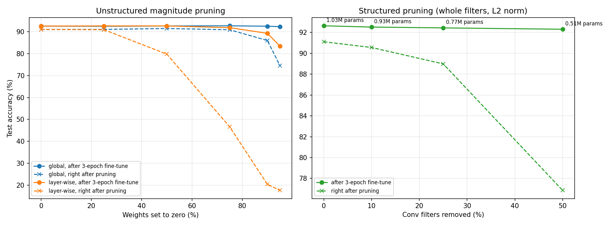

# Lab 7: compression: pruning and distillation

## Goal

Make an oversized CNN smaller with magnitude pruning (global, layer-wise and
structured) and with knowledge distillation, and check honestly what each
method saves: accuracy, parameters, size on disk, latency, compute and
energy.

## Method

**Data.** Fashion-MNIST through torchvision, `ToTensor()` and
`Normalize((0.2860,), (0.3530,))`. The official training set is split 55,000
for training and 5,000 for validation (seed 42), and the official 10,000
images are the test set. Batch size 128. Every run starts from seed 42 and
sees the batches in the same order.

**Baseline (teacher).** conv 1→32 → pool → conv 32→64 → pool → linear
3136→320 → linear 320→10, with 3×3 kernels and ReLU. It has **1,025,866
parameters**. It is trained with Adam (lr 1e-3) for 5 epochs.

**Unstructured magnitude pruning.**

- All four weight tensors are ranked by |w|. The 426 biases are not pruned.
- Two ways to rank:
  - **global**: one ranking over all 1,025,440 weights;
  - **layer-wise**: the same share in every layer.
- Sparsity targets: 0, 25, 50, 75, 90 and 95 %. The smallest weights are
  multiplied by a 0/1 mask.
- Each pruned model is fine-tuned for 3 epochs (Adam, lr 5e-4). The mask is
  applied again after every optimiser step, so pruned weights stay at zero.
- Fine-tuning gives the pruned models 3 more epochs than the baseline, so the
  fair 0 % point is a **control**: the dense baseline trained for the same 3
  extra epochs.

**Structured pruning.**

- In both conv layers, 10, 25 and 50 % of the filters with the smallest L2
  norm are removed.
- Removing a filter also removes the input channel it fed in the next layer.
  For conv2 it also removes the 49 inputs of fc1 that came from that channel.
- The result is a smaller dense network, which is then fine-tuned for
  3 epochs.

**Latency and size.**

- **Latency:** the 10 models of interest are timed together, called in turn
  so that a change in CPU speed affects all of them equally. After a warm-up,
  the median of 200 calls is taken at batch 1 and of 30 calls at batch 128.
  CPU: Ryzen 5 5600U, 6 threads, PyTorch 2.3.1.
- **Size:** the state dict is saved four ways:
  - dense (`torch.save`);
  - dense compressed with gzip;
  - sparse COO;
  - sparse CSR (each weight tensor reshaped to 2-D).
- **Kernel test:** fc1 is multiplied by 128 inputs once as a dense matrix and
  once as a CSR matrix, at increasing sparsity.

**Distillation.**

- **Student:** conv 1→16 → conv 16→32 → linear 1568→64 → linear 64→10,
  **105,866 parameters**.
- **Two versions from the same initial weights and batch order,** 5 epochs
  each:
  - plain cross-entropy;
  - the distillation loss
    `alpha·CE(student, labels) + (1 − alpha)·T²·KL(softmax(student/T) || softmax(teacher/T))`,
    with T = 4 and alpha = 0.5.
- In code the KL term is
  `F.kl_div(log_softmax(student/T), softmax(teacher/T))`, the PyTorch form of
  this formula: the student is the input and the teacher's softened
  probabilities are the target.
- The teacher is frozen (eval mode, no gradients).
- Because one run is a single sample, both students are trained with three
  seeds (42, 43, 44).

**Energy.** I have no power meter, so energy is an estimate: time × 15 W, the
TDP of the CPU. It is an upper bound that assumes the whole package is busy,
useful only to compare the models with each other.

Everything runs with `python lab07/src/lab7.py`. Trained weights are cached
in `data/` (not committed); add `--fresh` to retrain from scratch.

## Results

### Baseline

| Parameters | Size (dense) | FLOPs per image | Latency, batch 1 | Latency, batch 128 | Test accuracy |
|---|---|---|---|---|---|
| 1,025,866 | 4,009.8 KB | 9.69 M | 0.494 ms | 18.58 ms | 91.10 % (92.63 % after the 3-epoch control) |

97.8 % of the parameters are in fc1 (1,003,520 weights). But 75 % of the
compute is in conv2 (7.2 of 9.7 M FLOPs), because its small kernels are
reused at every position of the image.

### Sparsity curves

**Unstructured pruning, test accuracy** (before → after the 3-epoch
fine-tune; the 0 % "after" value is the dense control):

| Weights set to zero | Global | Layer-wise |
|---|---|---|
| 0 % | 91.10 → 92.63 | 91.10 → 92.63 |
| 25 % | 91.11 → 92.54 | 90.98 → 92.70 |
| 50 % | 91.53 → 92.69 | 79.83 → 92.71 |
| 75 % | 90.95 → 92.76 | 46.64 → 91.91 |
| 90 % | 86.05 → 92.57 | 20.36 → 89.33 |
| 95 % | 74.63 → 92.38 | 17.59 → 83.47 |

- **Global pruning removes 95 % of the weights and loses only 0.25 points**
  against the control.
- **Layer-wise pruning collapses** to 17.6 % right after pruning at 95 % and
  ends 9.2 points below the control.
- **Why the difference:** the two methods choose different weights.
  - Global pruning at 95 % keeps 87.8 % of conv1, 27.3 % of conv2 and only
    4.5 % of fc1. It cuts where the weights are redundant.
  - Layer-wise pruning also cuts 95 % of the 288 conv1 weights that every
    later layer depends on.

**Structured pruning, test accuracy:**

| Filters removed | conv1 / conv2 filters | Parameters | FLOPs per image | Before → after fine-tune |
|---|---|---|---|---|
| 0 % | 32 / 64 | 1,025,866 | 9.69 M | 91.10 → 92.63 (control) |
| 10 % | 29 / 58 | 928,456 | 8.17 M | 90.55 → 92.51 |
| 25 % | 24 / 48 | 766,826 | 5.91 M | 88.98 → 92.43 |
| 50 % | 16 / 32 | 510,090 | 3.04 M | 76.86 → 92.30 |

Removing half the filters costs 0.33 points after fine-tuning and cuts the
FLOPs by 69 %.

### Latency and size: an honest analysis

| Model | Non-zero weights | FLOPs (dense / only non-zero) | Batch 1 | Batch 128 |
|---|---|---|---|---|
| Baseline | 1,025,440 | 9.69 M / 9.69 M | 0.494 ms | 18.58 ms |
| Global 50 % | 512,719 | 9.69 M / 7.32 M | 0.490 ms | 18.65 ms |
| Global 90 % | 102,544 | 9.69 M / 3.59 M | 0.485 ms | 19.01 ms |
| Global 95 % | 51,271 | 9.69 M / 2.46 M | 0.491 ms | 19.14 ms |
| Layer-wise 90 % | 102,544 | 9.69 M / 0.97 M | 0.486 ms | 18.15 ms |
| Structured 10 % | 928,039 | 8.17 M | 0.459 ms | 16.95 ms |
| Structured 25 % | 766,424 | 5.91 M | 0.404 ms | 13.28 ms |
| Structured 50 % | 509,712 | 3.04 M | 0.334 ms | 8.16 ms |

- **Unstructured pruning does not make the model faster at all.** At 95 %
  zeros the latency is the same as the baseline within run-to-run noise
  (a few percent; even two students with identical architecture differ by 6 %).
- **Structured pruning gives a real speed-up:** at 50 % it is 1.48× faster
  at batch 1 and 2.28× faster at batch 128. That is less than its 3.2× fewer
  FLOPs, because pooling, activations and call overhead do not shrink with
  the number of filters.

**On-disk size of the state dict:**

| Sparsity (global) | Dense | Dense + gzip | Sparse COO | Sparse CSR |
|---|---|---|---|---|
| 0 % | 4,009.8 KB | 3,723.3 KB | 20,325.9 KB | 12,026.5 KB |
| 50 % | 4,009.8 KB | 2,221.4 KB | 10,258.4 KB | 6,018.0 KB |
| 75 % | 4,009.8 KB | 1,279.7 KB | 5,203.0 KB | 3,013.8 KB |
| 90 % | 4,009.8 KB | 661.1 KB | 2,131.4 KB | 1,211.3 KB |
| 95 % | 4,009.8 KB | 440.6 KB | 1,089.2 KB | 610.4 KB |

- **Dense format:** the file does not shrink, because zeros are stored like
  any other number.
- **Sparse formats:** they store an index next to every non-zero value.
  - COO keeps 2 or 4 int64 indices per value, so it is larger than dense
    until about 80 % sparsity.
  - CSR keeps one int64 column index per value plus row pointers, so it
    breaks even at about 70 %.
- **Gzip of the dense file** is smallest here, because long runs of zeros
  compress well.

**Dense vs CSR matrix product for fc1 (320×3136) with 128 inputs:**

| Sparsity | 0 % | 50 % | 75 % | 90 % | 95 % | 99 % |
|---|---|---|---|---|---|---|
| Dense | 1.20 ms | 1.16 ms | 1.14 ms | 1.15 ms | 1.14 ms | 1.08 ms |
| CSR | 5.97 ms | 3.63 ms | 2.04 ms | 0.68 ms | 0.36 ms | 0.13 ms |
| CSR / dense | 4.97× | 3.13× | 1.78× | 0.59× | 0.31× | 0.12× |

**Why unstructured sparsity rarely speeds up dense CPU kernels.**

- A dense kernel (BLAS for linear layers, oneDNN for convolutions) reads the
  matrix in order and multiplies 8 floats per instruction. It never checks
  for zeros, because a check costs more than the multiplication. A pruned
  model that is still stored densely therefore does exactly the same work.
  This is what the latency table shows.
- To skip zeros, a sparse kernel has to read an index for every non-zero
  weight and then jump to that position in the input. That is irregular
  memory access, and it vectorises badly. So CSR is 5 times slower than dense
  at 0 % and overtakes it somewhere between 75 and 90 % sparsity.
- Even then, the gain does not reach the whole model:
  - most of the compute is in the convolutions, and PyTorch on CPU has no fast
    kernel for sparse convolution weights;
  - global pruning keeps conv1 and conv2 relatively dense anyway.
- Structured pruning avoids all of this: it makes the dense matrices
  themselves smaller, so the normal fast kernels simply do less work.

### Distillation vs plain student

| Model | Parameters | Test accuracy (seed 42) | Size | Batch 1 | Batch 128 | Training time |
|---|---|---|---|---|---|---|
| Teacher (baseline) | 1,025,866 | 91.10 % | 4,009.8 KB | 0.494 ms | 18.58 ms | 211.7 s |
| Student without teacher | 105,866 | 89.65 % | 416.0 KB | 0.265 ms | 8.05 ms | 99.2 s |
| Student with distillation | 105,866 | 89.83 % | 416.0 KB | 0.263 ms | 7.59 ms | 138.4 s |

The two students have the same architecture, so their size and speed are the
same. The 6 % difference at batch 128 is measurement noise. Distillation
makes training 40 % slower, because every batch also runs through the
teacher.

**Repeated with three seeds (test accuracy):**

| Seed | Without teacher | With distillation | Gain |
|---|---|---|---|
| 42 | 89.65 % | 89.83 % | +0.18 |
| 43 | 89.67 % | 89.68 % | +0.01 |
| 44 | 89.74 % | 89.42 % | −0.32 |
| Mean ± std | 89.69 ± 0.05 % | 89.64 ± 0.21 % | −0.04 |

**On this setup distillation brings no reliable gain.** The +0.18 of the first
run did not repeat. The likely reason is that the teacher is not much better
than the student: 91.1 % against 89.7 %, a gap of only 1.4 points. Its
softened probabilities carry little information that the labels do not
already give, after only 5 epochs. Compressing a strong teacher into the
student still worked in one sense: the student has 9.7 times fewer
parameters, is 1.9-2.3 times faster, and is only 1.4 points behind.

### Summary by the efficiency pillars of Chapter 9

| Model | Accuracy | **Data**: training images processed | **Model**: non-zero params / smallest file | **Compute**: FLOPs per image (dense / only non-zero), latency batch 128 | **Energy** (est.): per image / training |
|---|---|---|---|---|---|
| Baseline | 91.10 % | 275 k | 1,025,440 / 3,723 KB (gzip) | 9.69 M / 9.69 M, 18.6 ms | 2.18 mJ / 3.2 kJ |
| Global 95 % | 92.38 % | 440 k | 51,271 / 441 KB (gzip) | 9.69 M / 2.46 M, 19.1 ms | 2.24 mJ / 4.9 kJ |
| Layer-wise 90 % | 89.33 % | 440 k | 102,544 / 667 KB (gzip) | 9.69 M / 0.97 M, 18.1 ms | 2.13 mJ / 4.8 kJ |
| Structured 50 % | 92.30 % | 440 k | 509,712 / 1,856 KB (gzip) | 3.04 M, 8.2 ms | 0.96 mJ / 4.3 kJ |
| Student (plain) | 89.65 % | 275 k | 105,744 / 386 KB (gzip) | 2.23 M, 8.0 ms | 0.94 mJ / 1.5 kJ |
| Student (distilled) | 89.83 % | 275 k + teacher's 275 k soft labels | 105,744 / 386 KB (gzip) | 2.23 M, 7.6 ms | 0.89 mJ / 5.3 kJ with teacher training |

- **Data:** pruned models reuse the baseline and add 3 epochs (165 k images).
  The distilled student also needs a trained teacher and a teacher forward
  pass for each of its 275 k training images.
- **Energy per image:** latency at batch 128 divided by 128, times 15 W.
- **Training energy:** total training time, including the baseline that a
  pruned or distilled model depends on, times 15 W. Both energy columns are
  estimates.

**Conclusion.**

- **Global unstructured pruning** gives the best accuracy per stored byte:
  92.4 % with 95 % of the weights removed and a 441 KB compressed file. It
  saves storage and transmission, not time or energy on a CPU.
- **Structured pruning** is the method that actually saves compute and
  energy: half the filters cost 0.3 points and cut latency and energy per
  image by more than half.
- **The small student** is the cheapest model to run and to train, but it
  loses about 1.5 points, and distillation did not change that here.

For a CPU deployment, structured pruning of the large model is the best
trade-off.

## Three conclusions

1. **Fewer non-zero weights is not the same as faster.** Unstructured pruning
   to 95 % kept the accuracy and shrank the compressed file 8 times, but the
   latency did not move. Dense CPU kernels multiply the zeros anyway.
   Structured pruning, which really shrinks the matrices, gave a 2.3× speed-up
   at batch 128.
2. **How you choose what to prune matters more than how much.** Global ranking
   removed 95 % of the weights for a 0.25-point loss, because it took them from
   the redundant fc1. Layer-wise pruning at the same level lost 9 points,
   because it also gutted the 288-weight conv1 layer.
3. **Distillation needs a teacher that knows more than the student.** With a
   teacher only 1.4 points better, the distilled student was no better than
   the plain one over three seeds (−0.04 points on average), while training
   40 % longer. Repeating with several seeds was necessary: a single run
   showed a misleading +0.18.
